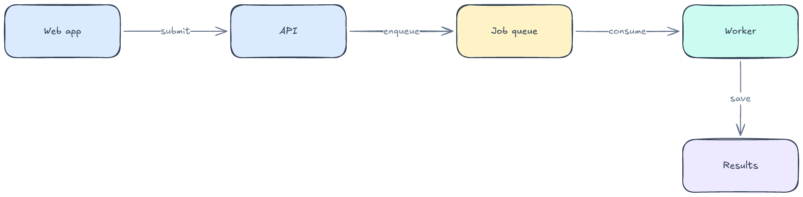
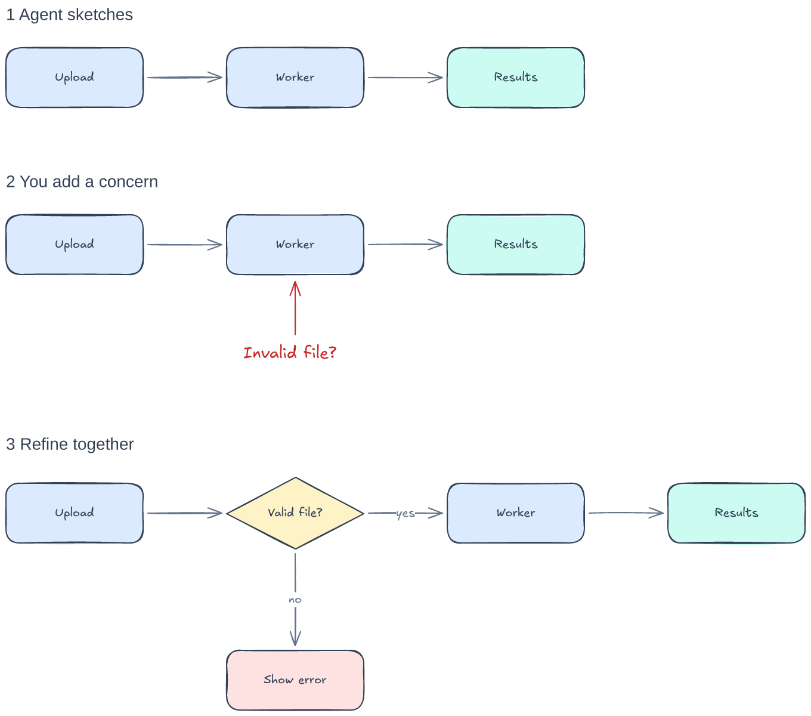
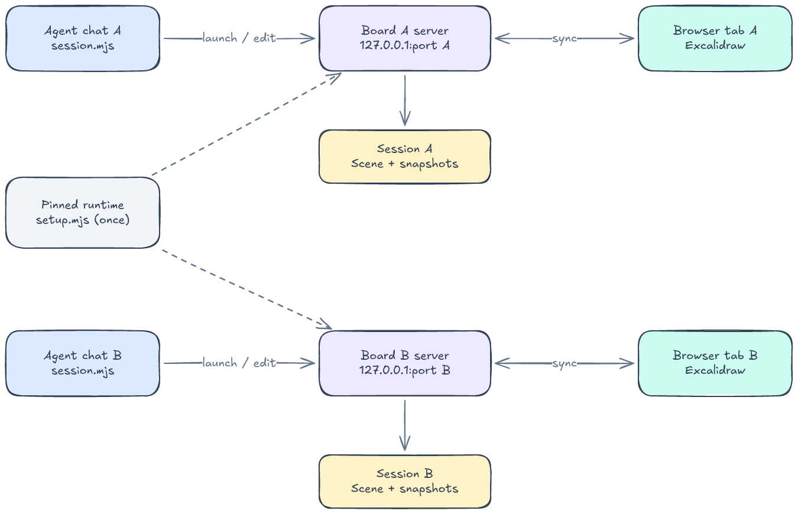

# Excalidraw Whiteboard Skill

Draw, discuss, and refine the same local Excalidraw board with Codex or Claude Code. The agent uses diagrams to explain a design; you use edits and sketches to communicate constraints, questions, and alternative approaches back to the agent.

## Install and bootstrap

Requires **Node.js 20+**, npm, Git, and a local browser. Tested on macOS with Node 24 and Chrome. Setup downloads and builds the pinned open-source runtime; allow a few minutes for the first install.

```sh
git clone https://github.com/jimjeffers/excalidraw-whiteboard-skill.git
cd excalidraw-whiteboard-skill

# Install for either agent, or run both commands.
npm run install:skill          # Codex: ~/.codex/skills/whiteboard
npm run install:skill:claude   # Claude Code: ~/.claude/skills/whiteboard

# Build and install the shared local runtime once.
npm run setup
```

No Excalidraw account, API key, Docker, or MCP server is needed. The editor, service, and fonts run locally after setup. Your agent's normal access requirements still apply. This is a local desktop workflow; a cloud-only agent cannot access your computer's loopback address.

In a chat with the installed skill available, ask:

> Use the whiteboard skill to draw a high-level background job system for this project. Open the board so we can iterate together.

The agent starts a named board and opens its returned URL, or supplies a link if it cannot open a browser. You can also invoke `$whiteboard` in Codex.

## What you can draw

This background-job diagram was created through the skill's session CLI and rendered by the local Excalidraw runtime. Its shapes, arrows, and labels remain editable.



[Download the editable board](examples/background-jobs.excalidraw).

The skill defaults to a succinct, high-level view. It keeps supporting explanations in chat, gives each connector one label, checks label spacing, and inspects a fresh image before delivery. Ask for more detail when you need it.

## Work together

The whiteboard is a shared conversation surface. A question beside a component, a new connection, or a rearranged group can express a concern that is hard to describe in chat alone.

1. Ask the agent to sketch a system, function, or process.
2. Edit the same board in your browser: move a component, rename it, or draw a new connection.
3. Wait for sync, or click **Sync to Backend**, then tell the agent to read the board.
4. Discuss the changes. The agent reads scene data and a fresh image, saves a snapshot before substantial edits, and updates the relevant elements.
5. Export an editable `.excalidraw` file and PNG when an iteration is ready.

Drawing does not automatically wake the agent. Comparing versions is an explicit agent step using a saved export or snapshot; there is no automatic change feed or per-author history. Take turns editing: simultaneous browser and agent writes can overwrite each other.

### Example: use your drawing to explain a missing case

In this illustrated scenario, you're designing an upload-processing flow. The whiteboard shows three stages of the same design conversation. All stages were drawn for this example with the skill.



[Download the editable conversation example](examples/collaborative-iteration.excalidraw).

**Start with the agent's sketch.** Ask: “Draw the high-level path from uploading a file to getting processed results.” The agent draws the first stage and saves an export as a baseline for later comparison.

**Use the canvas to explain your concern.** In your browser, add “Invalid file?” in red and point an arrow at the worker. The original success path stays intact, while your annotation identifies the missing case and where it matters.

After the edit syncs, continue in chat:

> Read the board. I added a question beside the worker. What should happen when someone uploads an invalid file?

**Discuss what changed.** The agent reads the current elements and a fresh image, then compares them with the saved first pass. An example response:

> You added an “Invalid file?” question pointing at the worker. The upload-to-results path is unchanged. We could validate the file before processing and show an error if validation fails. What makes a file invalid for this project?

Your reply connects the sketch to a concrete requirement:

> For this example, reject unsupported formats. Add that check and the error path, and keep the rest high-level.

**Refine the shared design.** The agent saves a snapshot and adds the decision and error branch shown in stage three, keeping your concern visible until you agree it is resolved. You can then revise the diagram again or use it to guide implementation.

## Architecture: one server per board session



[Download the architecture whiteboard](examples/session-architecture.excalidraw).

`setup.mjs` fetches a pinned community runtime, applies the included dependency patch, builds the editor and server, and installs them under `~/.local/share/codex-whiteboard/`. The installed runtime is independent of this checkout and shared by the Codex and Claude Code skill copies. Dashed arrows in the diagram indicate that both servers use that build.

For each `start`, `session.mjs` creates a UUID, selects an available loopback port, launches a detached Node process through `serve.mjs`, and assigns a separate data directory. The agent calls the service through the CLI and REST API; the browser syncs through WebSocket. `SKILL.md` supplies the workflow; the scripts handle setup, launch, routing, and persistence.

| Resource | Scope |
| --- | --- |
| Pinned runtime and fonts | Shared installation |
| Server process and `127.0.0.1` port | One per running board |
| Scene, snapshots, logs, and operation lock | One directory per session ID |
| `.excalidraw` and PNG exports | Explicit files in the selected project |

Separate chats create separate boards by default. Reusing an existing session ID deliberately shares that board across chats or agent apps. Names are descriptive and need not be unique; there is no automatic chat-to-board association.

The helper serializes its commands for a session and verifies the server's session ID, launch identity, and PID before routing edits or stopping it. It refuses mismatched listeners instead of adopting another service. Ports are selected dynamically, rather than requiring a fixed port; port selection and startup are not atomic, so an unusually timed collision can still cause a launch failure. These checks prevent common routing mistakes, not concurrent editing conflicts within a shared board.

Servers survive the launching chat and terminal. `stop` preserves saved data; `open` restarts the same board and returns its current URL. The port may change after a restart. Nothing starts automatically at login.

## Use the CLI directly

From this checkout:

```sh
SESSION_CLI="$PWD/skills/whiteboard/scripts/session.mjs"
node "$SESSION_CLI" start --project /absolute/path/to/project --name "API design"
```

Save the returned `id` and open the returned `url`. Substitute that ID below:

```sh
node "$SESSION_CLI" list --project /absolute/path/to/project
node "$SESSION_CLI" open SESSION_ID
node "$SESSION_CLI" run SESSION_ID describe
node "$SESSION_CLI" run SESSION_ID snapshot save before-change
node "$SESSION_CLI" run SESSION_ID export --out design.excalidraw
node "$SESSION_CLI" run SESSION_ID screenshot --out design.png
node "$SESSION_CLI" stop SESSION_ID
```

From any directory, point `SESSION_CLI` at the installed skill's absolute path. Export paths resolve relative to the session's project. Exports are copies; editing an exported file does not update the live board. See [drawing commands](skills/whiteboard/references/drawing.md) and [session operations](skills/whiteboard/references/operations.md) for editing, imports, snapshots, and recovery.

## Skill structure and updates

```text
skills/whiteboard/
├── SKILL.md                    # Workflow and drawing rules
├── agents/openai.yaml          # Codex display metadata
├── references/
│   ├── drawing.md              # Scene operations and layout guidance
│   └── operations.md           # Setup, persistence, troubleshooting
└── scripts/
    ├── setup.mjs               # Pinned runtime installation
    ├── session.mjs             # Session lifecycle and CLI routing
    ├── serve.mjs               # Server launch and identity endpoint
    ├── common.mjs              # Paths and runtime configuration
    ├── check-layout.mjs        # Read-only connector checks
    └── dependency-lock.patch   # Recorded dependency changes
```

Edit `skills/whiteboard/`, then rerun the appropriate `install:skill` command. Each installation replaces the whole skill folder and backs up the old copy under that agent profile's `skill-backups/` directory. The Codex installer respects `CODEX_HOME`; the Claude installer uses `~/.claude`. Board data is kept separately.

Run installers and board operations sequentially. Rerun setup when a runtime update requires it; setup reuses an already installed version. For checks and the original prototype, see [development](docs/development.md).

## Limits and credits

This is an experimental local tool, tested on macOS; other platforms are unverified. The service is unauthenticated and must stay on loopback. It is not a remote multi-user service. The pinned frontend/build dependency tree still has audit findings. The layout checker detects common connector issues but does not replace visual review.

The runtime is [yctimlin/mcp_excalidraw](https://github.com/yctimlin/mcp_excalidraw/tree/8084a1c8b410d625fcfd59d5cffb32f3a86a2a6f), a community toolkit embedding the official [Excalidraw editor](https://github.com/excalidraw/excalidraw). This skill is independent of both projects. MCP is available upstream but is not used by this skill's session workflow.

Released under the [MIT license](LICENSE). See [third-party notices](THIRD_PARTY_NOTICES.md) for upstream attribution.
